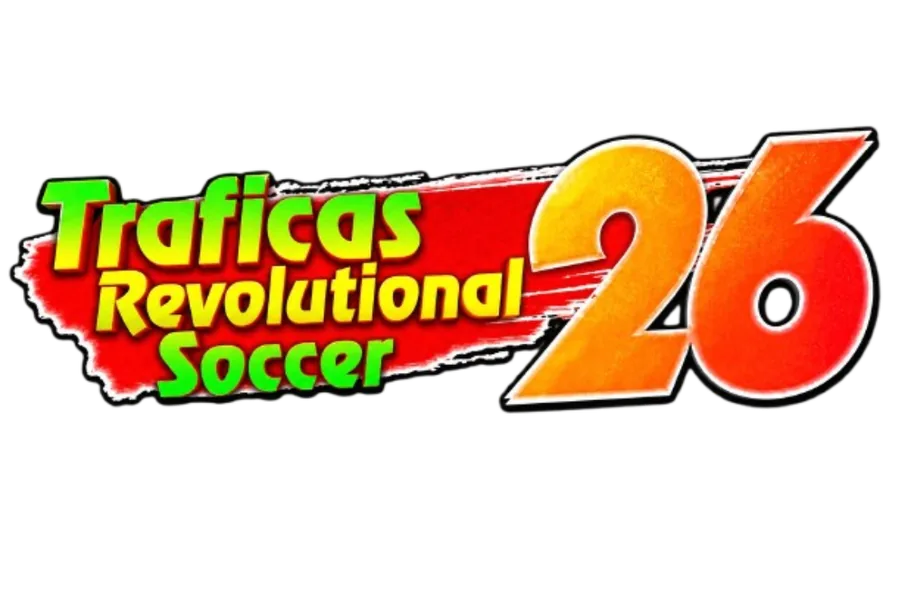
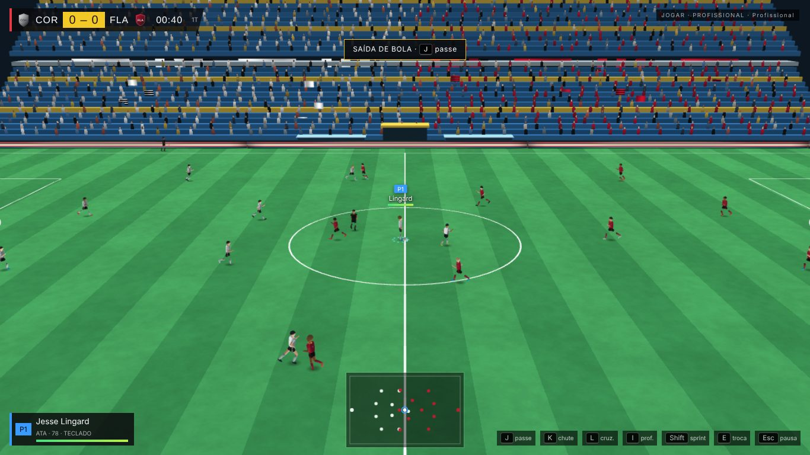
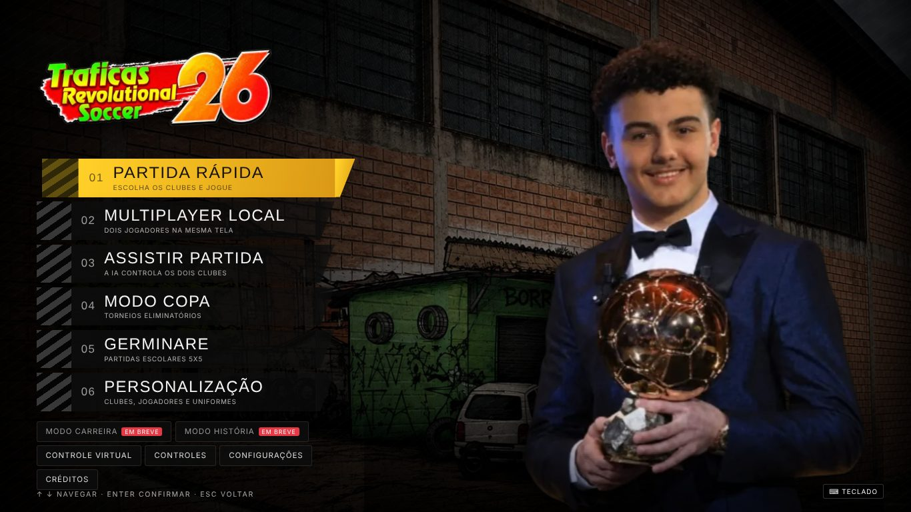
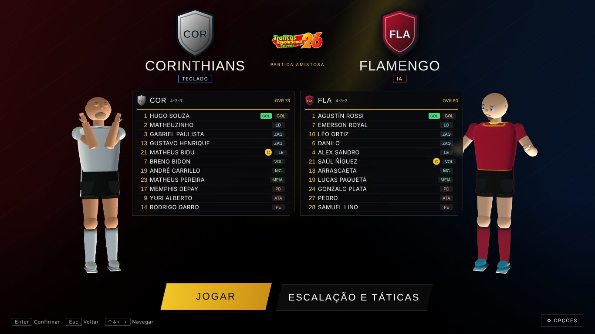
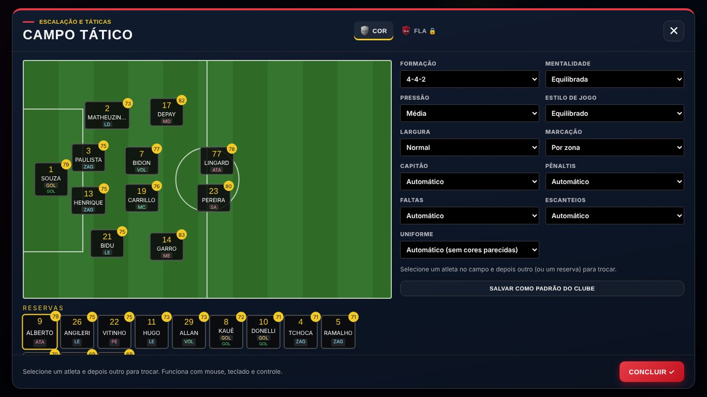
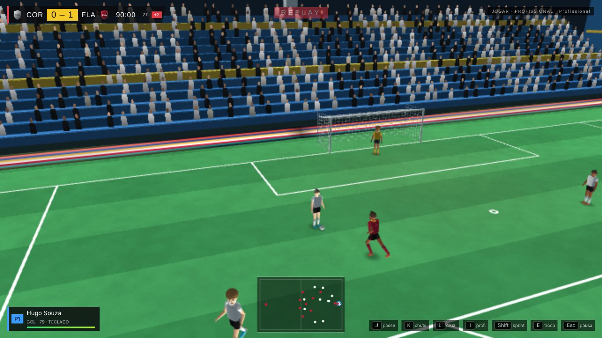
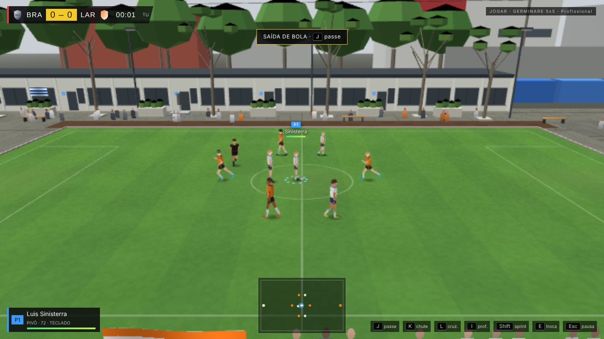
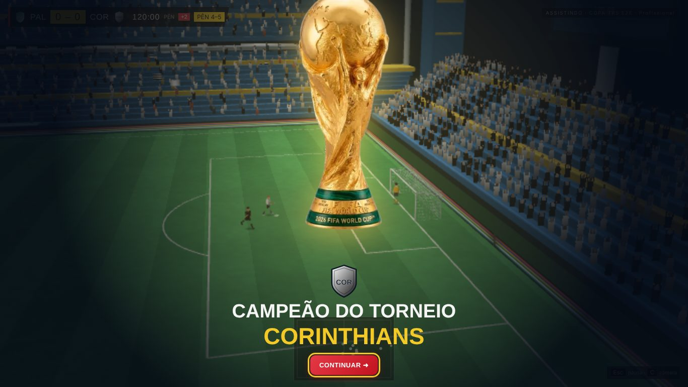

<div align="center">



# Traficas Revolution Soccer 26

**Jogo de futebol 3D no navegador, em homenagem ao grande Enzo Herrera, o Traficas.**<br/>
Física de bola, IA tática, regras completas, Modo Copa e Germinare 5x5. Abre com um duplo clique, sem instalar nada.

[](https://github.com/Traficas-Revolution-Soccer/game-trs/actions/workflows/test.yml)
[](https://github.com/Traficas-Revolution-Soccer/game-trs/releases)




</div>

---

## Sumário

- [Jogar agora](#jogar-agora)
- [O que tem no jogo](#o-que-tem-no-jogo)
- [Capturas](#capturas)
- [Controles](#controles)
- [Celular como controle](#celular-como-controle)
- [Estrutura do projeto](#estrutura-do-projeto)
- [Desenvolvimento](#desenvolvimento)
- [Limitações conhecidas](#limitações-conhecidas)
- [Roadmap](#roadmap)
- [Créditos e licença](#créditos-e-licença)

## Jogar agora

**Opção 1: HTML offline (a mais fácil).** Baixe o `TRS26_vX.Y.Z_OFFLINE.html` da [última release](https://github.com/Traficas-Revolution-Soccer/game-trs/releases/latest) e abra com um duplo clique. É um arquivo só, com tudo embutido, e funciona sem internet.

**Opção 2: pelo código.**

```bash
git clone https://github.com/Traficas-Revolution-Soccer/game-trs.git
```

Depois abra o `index.html` no navegador. Não tem etapa de build.

**Requisitos:** um navegador atual (Chrome ou Edge recomendados) com WebGL2. Sem WebGL2, o jogo passa sozinho para o modo Canvas 2D.

## O que tem no jogo

### Partida
- **Mundo contínuo e autoritativo** (`js/football/world.js`): passo fixo de 1/60 s, interpolação no desenho e semente reproduzível. A mesma semente gera o mesmo jogo.
- **Física de bola:** gravidade, arrasto, quique, efeito lateral e vertical (Magnus), traves, travessão e rede, em subpassos para nenhum chute atravessar a trave. O gol só vale com a bola inteira além da linha.
- **Corpos:** atletas não se atravessam; no choque, força e equilíbrio decidem quem cede.
- **Ações:** passes rasteiro, em profundidade, alto, cruzamento e longo; chutes com barra de força; cabeceio, desarme, carrinho, proteção e **12 dribles**.
- **Regras em tempo real:** lateral, escanteio, tiro de meta, impedimento no momento do passe, faltas com vantagem, cartões, pênalti, tiros livres, acréscimos, prorrogação e disputa de pênaltis em campo.
- **Durações reais** de 4 a 90 minutos, com replay de 14 s, pausa, intervalo e pós-jogo com notas.

### IA
- Táticas a 5 Hz e decisões individuais a 10 Hz: linha, compactação, pressão, cobertura e marcação.
- Goleiro com posicionamento, defesa planejada, saídas e reposição.
- Cinco dificuldades, de **Iniciante** a **Lendário**. Elas mudam a qualidade das decisões, não a velocidade dos jogadores.

### Modos
| Modo | O que é |
|---|---|
| **Partida rápida** | JOGAR, ASSISTIR (IA x IA) ou MELHORES MOMENTOS |
| **Modo Copa** | Mata-mata de qualquer tamanho ou grupos + mata-mata, chaveamento, artilharia, histórico de campeões e cerimônia do título |
| **Germinare** | 5x5 no campo da escola, com arquibancada de madeira, gol de ouro e montagem livre dos times |
| **Multiplayer local** | Dois jogadores no mesmo teclado, controles pela Gamepad API e até 4 celulares; co-op no mesmo time |
| Carreira e História | Em breve |

### Clubes e personalização
- **Catálogo** Continente → País → Liga → Clube, com elencos brasileiros de 2026 pesquisados e fonte registrada em [`data/fontes_elencos_2026.txt`](data/fontes_elencos_2026.txt). Overall e atributos são **estimativas** do jogo.
- **Criador de jogador** com rosto, corpo, cabelo, atributos e personalidade, e prévia 3D.
- **Estúdio de uniformes** com estampas, golas, até 5 patrocinadores, pintura sobre a textura e importação de moldes.
- Importação e exportação de clubes. Tudo fica salvo no navegador (localStorage e IndexedDB).

## Capturas

<table>
<tr>
<td><br/><sub>Menu principal</sub></td>
<td><br/><sub>Confronto pré-jogo</sub></td>
</tr>
<tr>
<td><br/><sub>Escalação e táticas</sub></td>
<td><br/><sub>Replay</sub></td>
</tr>
<tr>
<td><br/><sub>Germinare 5x5</sub></td>
<td><br/><sub>Campeão do Modo Copa</sub></td>
</tr>
</table>

Mais telas em [`docs/capturas/`](docs/capturas/).

## Controles

Tudo pode ser remapeado em **Menu → Controles**.

| Ação | Teclado 1 | Teclado 2 | Controle (Xbox / PlayStation) |
|---|---|---|---|
| Mover | `W` `A` `S` `D` | Setas | Direcional (analógico esquerdo também) |
| Sprint | `Shift` | `Num 0` | RT / R2 |
| Passe curto / pressão | `J` | `Num 1` | A / ✕ |
| Chute / carrinho | `K` | `Num 2` | B / ○ |
| Cruzamento / passe alto / desarme | `L` | `Num 3` | X / □ |
| Profundidade / goleiro sai | `I` | `Num 5` | Y / △ |
| Trocar jogador | `E` | `Num 4` | LB / L1 |
| Desarme / proteger a bola | `Espaço` | `Num ,` | LT / L2 |
| Habilidade (drible) | `Ctrl` | `Num 6` | L3 |
| Pedir apoio / tabela | `Q` | `Num 8` | RB / R1 |
| Pausar | `Esc` ou `P` | `Enter` do teclado numérico | Start / Options |
| Trocar câmera | `C` | | |

Os controles usam a Gamepad API, com zona morta, sensibilidade, inversão, vibração e ícones de Xbox ou PlayStation conforme o aparelho.

## Celular como controle

O celular vira um controle com analógico e botões multitoque: é só ler um QR code. A página do controle e o servidor de pareamento ficam no repo **[trs-mobile-device-management](https://github.com/Traficas-Revolution-Soccer/trs-mobile-device-management)**.

```bash
# os dois repos lado a lado
git clone https://github.com/Traficas-Revolution-Soccer/game-trs.git
git clone https://github.com/Traficas-Revolution-Soccer/trs-mobile-device-management.git

cd trs-mobile-device-management
node server/server.js --game ../game-trs
```

Abra o endereço que aparece no terminal e vá em **Menu → Controle virtual → CRIAR SESSÃO**. Celular e computador precisam estar na mesma rede Wi-Fi. Aberto como arquivo ou pelo HTML offline, o jogo funciona normalmente, só sem o celular.

## Estrutura do projeto

```
game-trs/
├── index.html              # ponto de entrada: telas e ordem dos scripts
├── styles.css, css/        # estilos (identidade TRS26 em css/trs26.css)
├── js/
│   ├── football/           # mundo contínuo (world.js) e IA (ai.js)
│   ├── input/input.js      # teclado, Gamepad API e celulares → um comando lógico
│   ├── gfx/                # WebGL2 (renderer3d, personagens, estádio, câmeras) e Canvas 2D
│   ├── ui/                 # telas: menu, partida, táticas, Copa, Germinare, editores
│   ├── rules.js, engine.js # leis do jogo e motor estatístico (usado em SIMULAR)
│   ├── tournament.js       # formatos e chaveamento do Modo Copa
│   └── data.js, catalog.js # clubes, migrações e catálogo
├── data/                   # catálogo 2026 e fontes dos elencos
├── assets/branding/        # logo, capa e poses do TRS26
├── tests/                  # testes Node (sem dependências) e e2e com Playwright
├── tools/                  # geradores do catálogo e do HTML offline
└── docs/                   # capturas e relatório de testes e limitações
```

Os scripts são JavaScript puro, carregados em ordem pelo `index.html`, e cada módulo se registra no objeto global `MD`. A simulação (`js/football/`, `rules.js`, `engine.js`) não depende do DOM, e por isso roda nos testes em Node.

## Desenvolvimento

**Requisitos:** Node.js 18+ para os testes, e Python 3 para o HTML offline e o e2e.

```bash
npm test                 # todos os conjuntos (~2 min)
npm run test:rapido      # sem os lentos: coreografia, mundo e Monte Carlo (~15 s)
npm run build:offline    # gera ../TRS26_OFFLINE.html
npm run build:catalog    # regera data/catalog_br_2026.* a partir das fontes
```

| Teste | O que cobre |
|---|---|
| `world.test.cjs` | Mundo jogável com um "humano" enviando comandos: movimento, passes, chutes, desarmes, reinícios, impedimento, pênalti, cartões, intervalo, determinismo, replay, Germinare e dificuldade |
| `physics.test.cjs` | Física: queda, rolagem, curva, topspin, trave e travessão a até 35 m/s, linha do gol, corpos dos atletas, velocidade de costas e determinismo |
| `input.test.cjs` | Celular como dispositivo de entrada: toques curtos entre dois quadros não se perdem |
| `rules.test.cjs` | Leis do jogo: faltas, impedimento, cartões, saídas de bola |
| `tournament.test.cjs` | Modo Copa: formatos, folgas, grupos, desempate em campo |
| `germinare.test.cjs` | Regras do 5x5 |
| `catalog.test.cjs` | Catálogo e migração de dados salvos |
| `pacing.test.cjs` | Relógio contextual dos melhores momentos |
| `choreo.test.cjs` | ~1.000 lances do motor estatístico |
| `montecarlo.test.cjs` | Equilíbrio do motor estatístico em 600 partidas |
| `e2e_test.py` | Navegador real (Playwright): menus, partida completa, Gamepad API emulada, Copa, Germinare e dois celulares pelo servidor |

O e2e precisa de `pip install playwright` e de um Chrome ou Chromium.

Quer contribuir? Veja o [CONTRIBUTING.md](CONTRIBUTING.md).

## Limitações conhecidas

- Testado só no Chrome, com WebGL por software. O FPS em GPU real, o Firefox e o Safari ainda não foram medidos.
- Controles físicos e celulares foram **emulados** nos testes.
- As ligas internacionais aparecem como **pendentes**, sem elencos inventados.
- A IA acerta menos passes que no futebol real e cai em impedimento demais.
- Sem estádios, rostos, escudos ou uniformes oficiais, por direitos.

O relatório completo está em [docs/LIMITACOES_E_TESTES.md](docs/LIMITACOES_E_TESTES.md).

## Roadmap

- [x] Mundo contínuo com física, IA e regras completas
- [x] Modo Copa e Germinare jogáveis
- [x] Teclado, Gamepad API e multiplayer local
- [x] Celular como controle, com QR code ([trs-mobile-device-management](https://github.com/Traficas-Revolution-Soccer/trs-mobile-device-management))
- [ ] Testes em GPU real, controles e celulares físicos
- [ ] Calibrar a IA: acerto de passes e impedimentos
- [ ] Elencos 2026 das ligas internacionais, com fontes
- [ ] Celular pela internet (WebRTC)
- [ ] Modo Carreira e Modo História

## Créditos e licença

Feito em homenagem a **Enzo Herrera, o Traficas**.

Os nomes de clubes e jogadores servem só como referência. Atributos e overall são estimativas do jogo, não avaliações oficiais. O hino e as músicas são temas originais sintetizados.

[MIT](LICENSE) © 2026 Traficas Revolution Soccer
